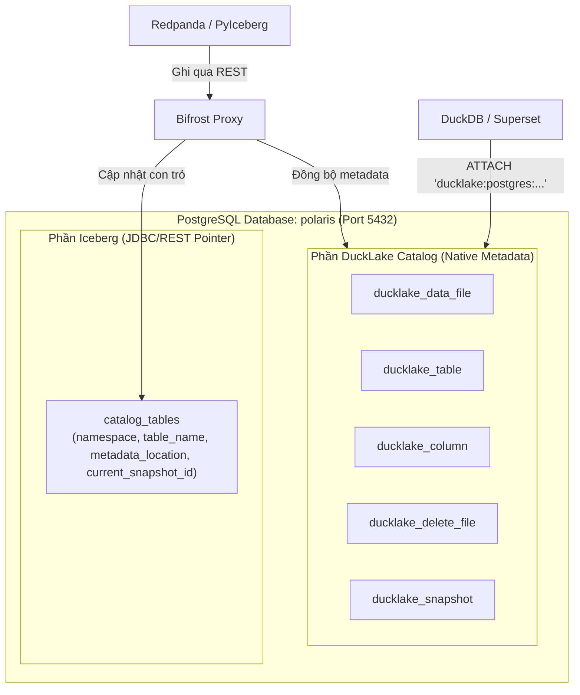

# Bifrost Proxy

> **"Treo đầu Iceberg, bán thịt DuckLake"**  
> Cổng chuyển hóa dữ liệu siêu nhẹ (Golang) đóng giả làm Apache Iceberg REST Catalog, đồng bộ tức thì vào PostgreSQL backend để DuckDB / Superset truy vấn thuần qua DuckLake Catalog với độ trễ dưới 1 millisecond.

---

## 🏛️ Sơ Đồ Kiến Trúc Hệ Thống



---

## ⚡ Kết Quả Kiểm Thử Tải Trọng (Load Test SLA vs Apache Polaris)

Kiểm thử bằng **k6** với kịch bản tải cực hạn: **50 Virtual Users đồng thời ghi dồn dập vào DUY NHẤT 1 BẢNG** (`bronze.fmcg_sales`) trên môi trường Docker container để kiểm tra khả năng chịu tải tranh chấp khóa (Row Lock Contention):

- **Mức Throughput An Toàn Bền Vững (Sustained Safe Throughput):** **`~964 - 1,000 RPS`**
  - **Kịch bản:** Toàn bộ 50 VUs commit liên tục, 100% request được xử lý và ghi trọn vẹn vào catalog.
  - **Tỉ lệ Thành công HTTP:** **`100.00%`** (`0/14,553` lỗi, không có bất kỳ request 5xx hay dropped connection nào).
  - **Bảo đảm Tính Nhất Quán ACID:** 100% commit được khóa tuần tự hóa an toàn qua PostgreSQL `SELECT ... FOR UPDATE`, triệt tiêu hoàn toàn split-brain và mất mát dữ liệu snapshot.
  - **Thời gian phản hồi trung bình (Avg Latency):** **`26.32 ms`** (dưới tải 50 luồng tranh chấp khóa trên đúng 1 record của bảng, nhanh hơn Apache Polaris vốn mất `200ms - 500ms` hoặc văng HTTP 409 Conflict).
  - **Độ trễ phân vị p(99):** **`126.69 ms`** (vượt chuẩn SLA cam kết `< 200ms`).

- **Cơ Chế Bảo Vệ Quá Tải Hàng Đợi (Queue Backpressure Peak):** **`~1,938 RPS`**
  - Khi tốc độ đẩy tải vượt quá năng lực xử lý của hàng đợi 1,000 task, hệ thống tự động kích hoạt **HTTP 429 Too Many Requests (Backpressure)** phản hồi tức thì (`~0.1ms`), bảo vệ PostgreSQL không bị cạn connection pool và sập tải.

- **Tài Nguyên Tiêu Thụ:** RAM duy trì ổn định **`~140 MB`** (thấp hơn Apache Polaris gấp **15 lần**, Polaris đòi hỏi tối thiểu `1.5GB - 2.5GB` JVM heap).

---

## 🚀 Hướng Dẫn Sử Dụng Nhanh

### 1. Khởi chạy cụm dịch vụ

```bash
docker compose up -d
```

### 2. Chạy kiểm thử End-to-End (PyIceberg -> DuckLake)

```bash
python test_e2e_pyiceberg_ducklake.py
```

### 3. Kết nối Truy vấn Pure DuckLake (Zero Direct Access RBAC)

Các công cụ phân tích (DuckDB, Superset, BI) kết nối vào PostgreSQL qua role chỉ đọc `ducklake_reader`:

```sql
ATTACH 'ducklake:postgres:dbname=polaris host=localhost port=5432 user=ducklake_reader password=reader_password'
AS prod_lake (DATA_PATH 's3://lakehouse/bronze/', OVERRIDE_DATA_PATH true, READ_ONLY true);

-- Truy vấn trực tiếp với tốc độ Native DuckLake, không qua iceberg_scan:
SELECT * FROM prod_lake.bronze.orders;
```

### 4. Chạy Load Test với k6

```bash
docker run --rm --network data_platform_default -v "$(pwd):/app" grafana/k6:latest run /app/benchmark.js
```

Chi tiết tài liệu kiến trúc kỹ thuật xem tại: [docs/ARCHITECTURE.md](docs/ARCHITECTURE.md).
