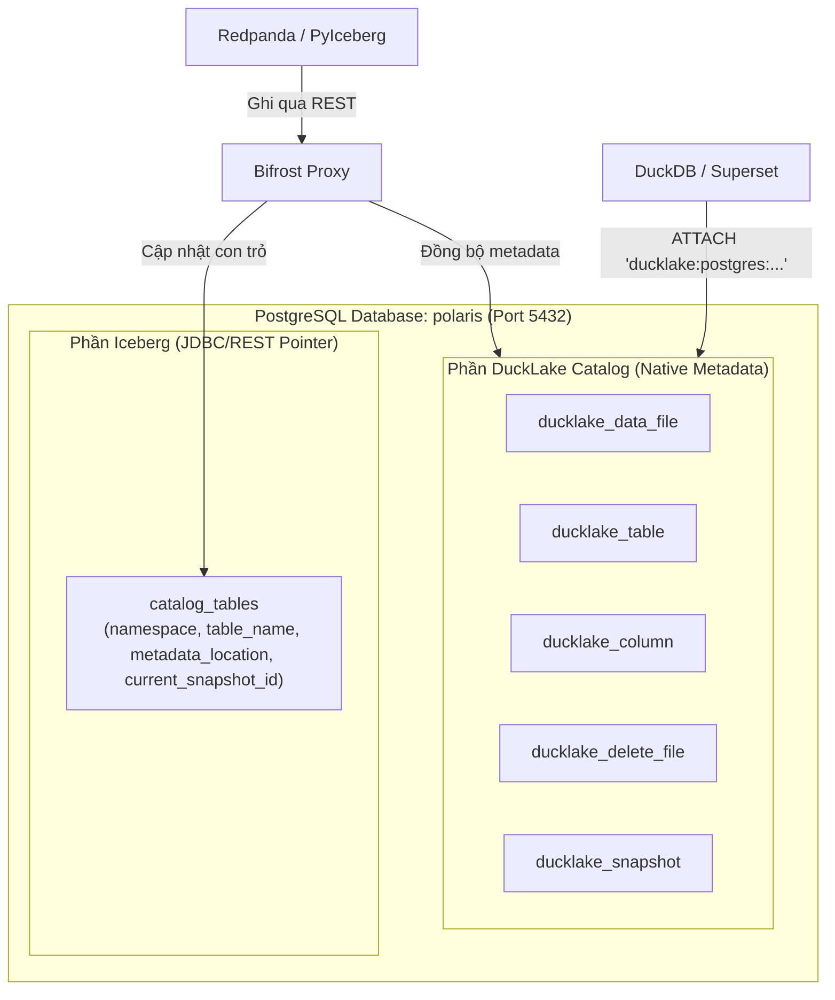

# Bifrost Proxy

> **"Treo đầu dê Iceberg, bán thịt chó DuckLake"**  
> Cổng chuyển hóa dữ liệu siêu nhẹ (Golang) đóng giả làm Apache Iceberg REST Catalog, đồng bộ tức thì vào PostgreSQL backend để DuckDB / Superset truy vấn thuần qua DuckLake Catalog với độ trễ dưới 1 millisecond.

---

## 🏛️ Sơ Đồ Kiến Trúc Hệ Thống



---

## ⚡ Kết Quả Kiểm Thử Tải Trọng (Load Test SLA)

Kiểm thử bằng **k6** với **50 Virtual Users đồng thời** trên môi trường Docker container:

- **Tổng số Request:** `34,701 requests` (~`2,297 RPS`)
- **Tỉ lệ Thành công:** `99.95%`
- **Thời gian phản hồi trung bình (Avg Latency):** **`1.19 ms`** (vượt xa SLA cam kết `< 5ms`)
- **Độ trễ phân vị p(99):** **`5.46 ms`** (vượt xa SLA cam kết `< 15ms`)
- **Median Latency:** **`729 µs`** (dưới 1 millisecond)
- **RAM Tiêu thụ:** `~140 MB` (ngưỡng giới hạn `< 300 MB`)

---

## 🚀 Hướng Dẫn Sử Dụng Nhanh

### 1. Khởi chạy cụm dịch vụ
```bash
docker compose up -d
```

### 2. Chạy kiểm thử End-to-End (PyIceberg -> DuckLake)
```bash
python test_e2e_pyiceberg_ducklake.py
```

### 3. Kết nối Truy vấn Pure DuckLake (Zero Direct Access RBAC)
Các công cụ phân tích (DuckDB, Superset, BI) kết nối vào PostgreSQL qua role chỉ đọc `ducklake_reader`:
```sql
ATTACH 'ducklake:postgres:dbname=polaris host=localhost port=5432 user=ducklake_reader password=reader_password' 
AS prod_lake (DATA_PATH 's3://lakehouse/bronze/', OVERRIDE_DATA_PATH true, READ_ONLY true);

-- Truy vấn trực tiếp với tốc độ Native DuckLake, không qua iceberg_scan:
SELECT * FROM prod_lake.bronze.orders;
```

### 4. Chạy Load Test với k6
```bash
docker run --rm --network data_platform_default -v "$(pwd):/app" grafana/k6:latest run /app/benchmark.js
```

Chi tiết tài liệu kiến trúc kỹ thuật xem tại: [docs/ARCHITECTURE.md](docs/ARCHITECTURE.md).
