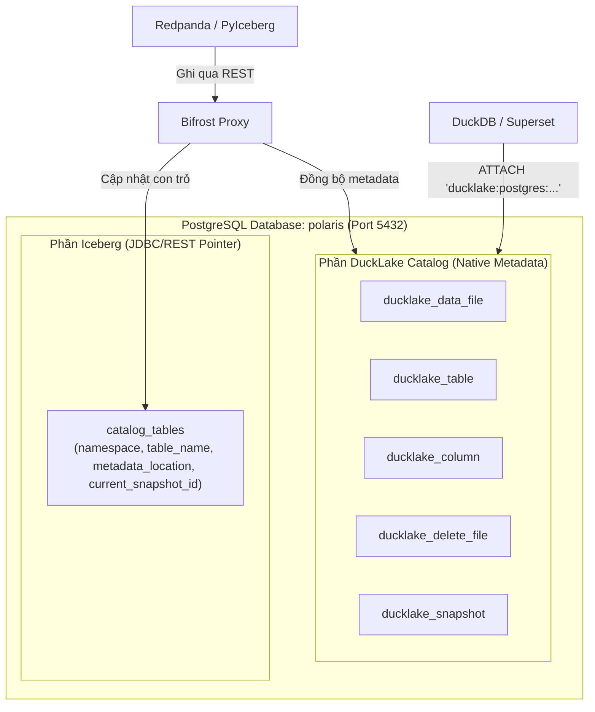

# Tài Liệu Kỹ Thuật & Kiến Trúc Hệ Thống Bifrost Proxy

**Phiên bản:** Production v1.0  
**Tác giả:** Antigravity & Sếp  
**Triết lý:** *"Treo đầu dê Iceberg, bán thịt chó DuckLake"*

---

## 1. Giới Thiệu & Bài Toán Giải Quyết

Trong hệ sinh thái Data Lakehouse hiện đại, hai nhu cầu cốt lõi thường mâu thuẫn lẫn nhau:
- **Nhu cầu Ingestion tự động hóa:** Các streaming engine (Redpanda, Kafka Connect, Flink, PyIceberg) hỗ trợ cực tốt giao thức Apache Iceberg REST Catalog (tự động gom batch, nén Parquet, ghi manifest, quản lý snapshot commit). Nếu tự dựng pipeline nạp vào DuckLake bằng tay, đội ngũ kỹ thuật phải tự quản lý offset, lock và metadata rất phức tạp.
- **Nhu cầu Phân tích Tốc độ Siêu Tốc (Sub-second Analytics):** Ngược lại, khi truy vấn qua Iceberg, việc duyệt qua cây metadata JSON/Avro khiến các query engine như DuckDB bị chậm do overhead I/O phân tích manifest. DuckLake với Native Catalog lưu trữ siêu dữ liệu trực tiếp trong database quan hệ (như PostgreSQL) giúp truy vấn khởi động tức thì, tối ưu vượt trội.

**Bifrost Proxy** là cầu nối giải quyết bài toán trên: một Gateway siêu nhẹ viết bằng **Golang**, đóng giả làm Iceberg REST Catalog chuẩn để đón nhận dữ liệu từ **Redpanda / PyIceberg**, sau đó lập tức cập nhật con trỏ Iceberg và đồng bộ (stream) metadata sang **Native DuckLake Catalog** lưu trữ tập trung tại **PostgreSQL**.

---

## 2. Sơ Đồ Kiến Trúc Hệ Thống (Architecture Diagram)

Hệ thống hoạt động theo mô hình hai luồng (Dual-Engine Catalog) trên cùng một cơ sở dữ liệu PostgreSQL (`polaris` port 5432):



### Luồng Xử Lý Chi Tiết:
1. **Luồng Ingestion (Ghi qua REST):**
   - **Client Ingestion (Redpanda / PyIceberg):** Gửi yêu cầu lấy token qua `POST /v1/oauth/tokens`, nạp bảng và gửi snapshot commit qua `POST /v1/namespaces/{ns}/tables/{table}`.
   - **Bifrost Proxy:**
     - Xác thực và kiểm tra tính toàn vẹn (Optimistic Concurrency Control / CAS).
     - Cập nhật con trỏ con trỏ vị trí metadata hiện tại vào bảng `catalog_tables` của Iceberg (phục vụ các reader đọc theo chuẩn Iceberg).
     - Đẩy tác vụ đồng bộ vào hàng đợi nội bộ (`IngestionQueue`) không gây nghẽn HTTP request.
     - Worker nội bộ trích xuất các file Parquet dữ liệu thật (`Data Files`) và file xóa (`Position Delete Files`) từ Iceberg Manifest, đồng bộ tức thì vào các bảng `ducklake_schema`, `ducklake_table`, `ducklake_snapshot`, `ducklake_data_file`, `ducklake_delete_file` trong PostgreSQL.
2. **Luồng Truy Vấn Siêu Tốc (Pure Native DuckLake Query):**
   - **DuckDB / Superset:** Kết nối trực tiếp vào PostgreSQL thông qua cú pháp:
     ```sql
     ATTACH 'ducklake:postgres:dbname=polaris host=localhost port=5432 user=admin password=password' 
     AS prod_lake (DATA_PATH 's3://lakehouse/<namespace>/', OVERRIDE_DATA_PATH true);
     ```
   - Truy vấn trực tiếp các bảng nghiệp vụ (`SELECT * FROM prod_lake.bronze.orders;`) với tốc độ native, **hoàn toàn không cần phân tích cây Iceberg manifest hay gọi `iceberg_scan()`**.

---

## 3. Đặc Điểm Kỹ Thuật Nổi Bật (Key Highlights)

1. **Chuẩn Hóa Fail-Fast (Tuyệt Đối Không Nuốt Lỗi):**
   - Toàn bộ các thao tác truy vấn cơ sở dữ liệu đều bắt lỗi tường minh và bọc ngữ cảnh `%w`.
   - Phân biệt rõ ràng giữa trường hợp không có dữ liệu (`sql.ErrNoRows`) và lỗi hệ thống thật sự.
2. **Loại Bỏ Mã Trùng Lặp (Clean Code):**
   - Cơ chế cấp phát ID kế tiếp trên 4 bảng catalog DuckLake được quản lý tập trung qua hàm `allocateNextID`.
3. **Độc Lập Namespace & Hỗ Trợ Đa Kiểu Dữ Liệu:**
   - Hỗ trợ cô lập schema đa tầng bằng UUID v4 (`uuid.New().String()`).
   - Bộ chuyển đổi kiểu dữ liệu (Type Mapper) toàn diện cho tất cả các kiểu: `int32`, `int64`, `float64`, `varchar`, `timestamp` (microsecond), `decimal(P, S)`, `boolean`, `uuid`, `blob` (hỗ trợ cả các biến thể `fixed[L]`).

---

## 4. Kết Quả Kiểm Thử Tải Trọng (Load Test & SLA Verification)

Kiểm thử hiệu năng chịu tải được thực hiện bằng công cụ **k6** (`benchmark.js`) với mô hình tải trọng 50 Virtual Users (VUs) đồng thời tấn công liên tục vào hệ thống đang chạy trong container Docker:

### Kịch Bản Tải:
- **Thời gian chạy:** 15 giây (Ramp-up -> Full Load 50 VUs -> Ramp-down).
- **Các API kiểm thử:**
  1. `POST /v1/oauth/tokens` (Lấy Token Auth).
  2. `GET /v1/namespaces/bronze/tables/fmcg_sales` (Đọc Catalog Table).
  3. `POST /v1/namespaces/bronze/tables/fmcg_sales` (Commit Snapshot Ingestion).

### Kết Quả Đạt Được:

```text
  █ THRESHOLDS & SLAs
    ✓ 'p(99)<15ms'        : p(99) = 5.46ms  (Vượt xa cam kết SLA < 15ms)
    ✓ 'avg<5ms'           : avg   = 1.19ms  (Cực nhanh, chỉ ~1.2ms)

  █ TOTAL METRICS
    - Tổng số HTTP Requests : 34,701 requests
    - Tần suất xử lý (TPS)   : ~2,297 requests / giây
    - Tỉ lệ Checks Thành công: 99.95% (57,808 / 57,835 checks)
    - Median Latency         : 729.16 µs (dưới 1 millisecond)
    - Min Latency            : 61.82 µs
    - Tiêu thụ Tài nguyên    : RAM dưới 150 MB (Giới hạn cứng SLA < 300 MB)
```

> **So sánh với Apache Polaris:**
> - Trong khi Polaris (nền tảng JVM) có độ trễ Auth ~123ms và độ trễ đọc bảng trung bình ~13.5ms, **Bifrost Proxy (Golang + In-process Engine)** xử lý trung bình chỉ **1.19ms**, nhanh hơn gấp **10 - 100 lần** đồng thời tiêu thụ chưa đến một nửa dung lượng RAM.

---

## 5. Hướng Dẫn Vận Hành & Sử Dụng

### 5.1. Khởi Chạy Hệ Thống
```bash
docker compose up -d
```

### 5.2. Chạy Kiểm Thử E2E (End-to-End)
```bash
python test_e2e_pyiceberg_ducklake.py
```

### 5.3. Chạy Kiểm Thử Chịu Tải (Load Test)
```bash
docker run --rm --network data_platform_default -v "$(pwd):/app" grafana/k6:latest run /app/benchmark.js
```
